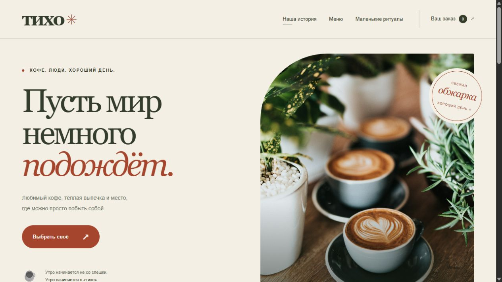
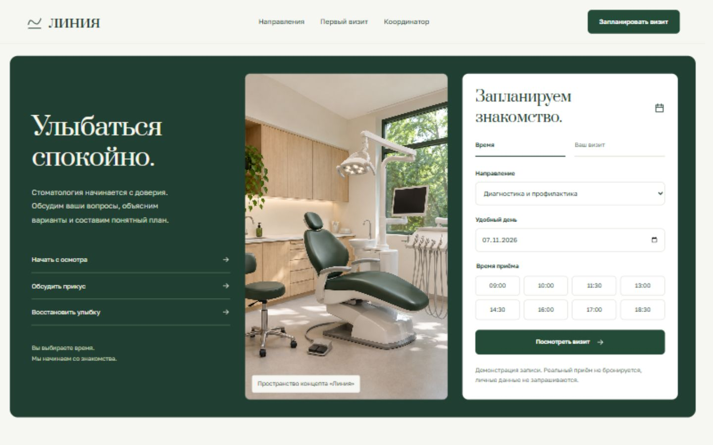
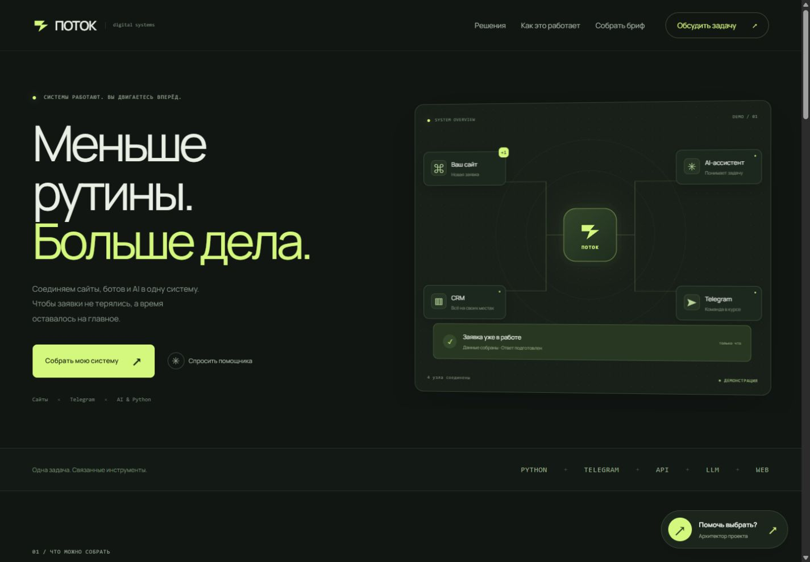

# Fle3n · Web Showcase

Три самостоятельных сайта для портфолио: разные визуальные стили, анимации, адаптивная вёрстка и полноценные демонстрационные сценарии. На каждом сайте есть помощник с текстовым вводом и действиями внутри интерфейса. Бренды «Тихо», «Линия» и «Поток» вымышлены; это концепты, а не выполненные клиентские заказы.

| Проект | Локальный адрес | Что можно попробовать |
| --- | --- | --- |
| **Тихо** · кофейня | http://localhost:1051 | Подбор напитка, бариста-помощник, объём и молоко, корзина, экспорт демочека |
| **Линия** · стоматология | http://localhost:1052 | Координатор, подбор направления, запись по шагам, календарь и копирование деталей |
| **Поток** · автоматизация | http://localhost:1053 | Помощник, сборщик брифа, выбор функций, экспорт, обработка своей заявки, калькулятор |

Контакт на всех сайтах: **[Telegram @fle3n](https://t.me/fle3n)**. Кнопки открывают личный чат разработчика; ничего автоматически не отправляется. WhatsApp не используется.

## Тихо

Тёплая палитра, крупная антиква, пар над чашками, плавное появление секций и движение фотографий от указателя. Карточки напитков нарисованы CSS. Квиз учитывает вкус и молоко; помощник также понимает бюджет. Добавки действительно меняют цену и сохраняются отдельными позициями корзины.



[Подбор напитка](previews/coffee-quiz.jpg) · [Диалог с бариста](previews/coffee-assistant.jpg)

## Линия

Светлый сайт с шалфейными оттенками, плавающими акцентами и анимированными раскрывающимися услугами. Координатор помогает с организационными вопросами и открывает нужное направление записи. Три этапа: направление и день → время → карточка визита. Можно скачать `.ics` или скопировать детали, без сбора персональных данных.



[Запись по шагам](previews/clinic-booking.jpg)

## Поток

Тёмный дизайн с лаймовым акцентом, анимированной схемой и орбитами, редактируемой заявкой и калькулятором времени. Помощник переносит задачу в сборщик: тип проекта → функции → готовый бриф. Бриф можно скачать, скопировать и вручную отправить разработчику в Telegram. Предпросмотр обновляется при вводе.



[Сборщик проекта с обновляемым предпросмотром](previews/flow-builder.jpg)

## Запуск

Нужен **Node.js 20+**. Установка npm-пакетов и сборка не требуются.

```sh
node server.mjs
```

Сервер одновременно запускает все три сайта на **0.0.0.0:1051–1053**. Для доступа из сети используйте IP компьютера и соответствующий порт. Для доступа извне настройте проброс этих TCP-портов на роутере и разрешение входящих соединений в вашей системе. Компьютер и процесс Node.js должны оставаться включены.

На Windows можно запустить скрытый фоновый процесс:

```powershell
.\Start-Sites.ps1
```

Или запустить его в текущем терминале с остановкой по Ctrl+C:

```powershell
.\Start-Sites.ps1 -Foreground
```

Фоновый запуск пишет PID и логи в игнорируемую Git папку `.runtime/`. После перезагрузки компьютера сайты нужно запустить снова. Для остановки фонового процесса проверьте PID в `.runtime/process.json` и завершите этот процесс Node.js в диспетчере задач.

## Устройство

```text
coffee/         HTML, CSS, JS кофейни
clinic/         HTML, CSS, JS клиники
flow/           HTML, CSS, JS студии автоматизации
assets/         Данные, помощники, квиз, сборщик, анимации, шрифты и фотографии
tests/          Тесты расчёта цен, рекомендаций и сборки брифа
previews/       Скриншоты сайтов
server.mjs      HTTP-сервер на трёх портах, без зависимостей
Start-Sites.ps1 Фоновый запуск для Windows
```

Все ресурсы локальные, включая шрифт Manrope: сайтам не нужны CDN или сторонние скрипты. Сервер раздаёт только файлы сайта и общие ресурсы. Корень репозитория, логи и другие файлы недоступны по HTTP. Поддерживаются GET и HEAD; сервер не принимает заявки и не хранит данные посетителей.

## Движение и адаптивность

- Появление первого экрана, секций при прокрутке, карточек, диалогов и сообщений.
- Пар над чашками, плавающие акценты, анимированная схема обработки и орбиты проекта.
- Закреплённая шапка, индикатор прокрутки, мобильная корзина и меню до 1040 px.
- Отдельная компоновка для телефона, планшета, промежуточных размеров и широкого монитора.
- Помощники, длинные сообщения и диалоги укладываются в маленький экран.
- `prefers-reduced-motion` отключает анимации. Кнопки и поля доступны с клавиатуры; Escape закрывает диалоги и помощника.

## Границы демонстраций

- Помощники работают локально: распознают темы и подбирают ответы и действия по данным сайта. **Внешняя языковая модель не подключена.** Неизвестные вопросы не выдают за достоверные ответы. Переписка не отправляется на сервер.
- Корзина «Тихо» хранится в `localStorage` текущего браузера. Демо не оформляет заказ и не принимает оплату. Чек помечен как демонстрационный.
- Запись «Линии» запрещает прошедшую дату и время, показывает пример расписания и не бронирует реальный приём. Цены демонстрационные, медицинские услуги не оказываются. Координатор не ставит диагнозы и не назначает лечение. Файл календаря также помечен как демонстрационный.
- По обычному HTTP браузер может ограничивать Clipboard API и загрузку календаря. Для копирования предусмотрено окно с выделенным текстом; детали визита можно скопировать вместо скачивания файла.
- Процесс «Потока» разбирает введённую заявку по ключевым темам и формирует локальную карточку. Реальные CRM, Telegram и AI не подключены. Кнопки связи ведут в Telegram @fle3n.
- Калькулятор использует формулу: `задач в день × минут на задачу × 22 рабочих дня × 70% / 60`. Это предварительная модель, не обещание коммерческого результата.

## Проверка

```sh
node --check server.mjs
node --check coffee/app.js
node --check clinic/app.js
node --check flow/app.js
node --test tests/logic.test.mjs
```

В браузере проверяются ширины 320, 360, 390, 430, 768, 820, 1024, 1280, 1440, 1920 и 2560 px; мобильные окна помощников, меню, квиз, настройка напитка, расчёт корзины, запись, бриф и выгрузки. HTTP-проверки отдельно проверяют ресурсы и ограничение доступа к файлам.

## Изображения

Фотографии загружены с Unsplash и включены локально. Они иллюстрируют концепты; люди на фото не являются сотрудниками вымышленной клиники.

- [Кофе — источник](https://images.unsplash.com/photo-1509042239860-f550ce710b93)
- [Выпечка — источник](https://images.unsplash.com/photo-1555507036-ab1f4038808a)
- [Стоматология — источник](https://images.unsplash.com/photo-1606811841689-23dfddce3e95)
- [Условия Unsplash](https://unsplash.com/license)

Шрифт [Manrope](https://github.com/google/fonts/tree/main/ofl/manrope) используется по SIL Open Font License. Текст лицензии включён в `assets/manrope-OFL.txt`.

## Автор

[Telegram — @fle3n](https://t.me/fle3n) · [GitHub — Fle3n](https://github.com/Fle3n) · [Kaggle — fleongg](https://www.kaggle.com/fleongg)
